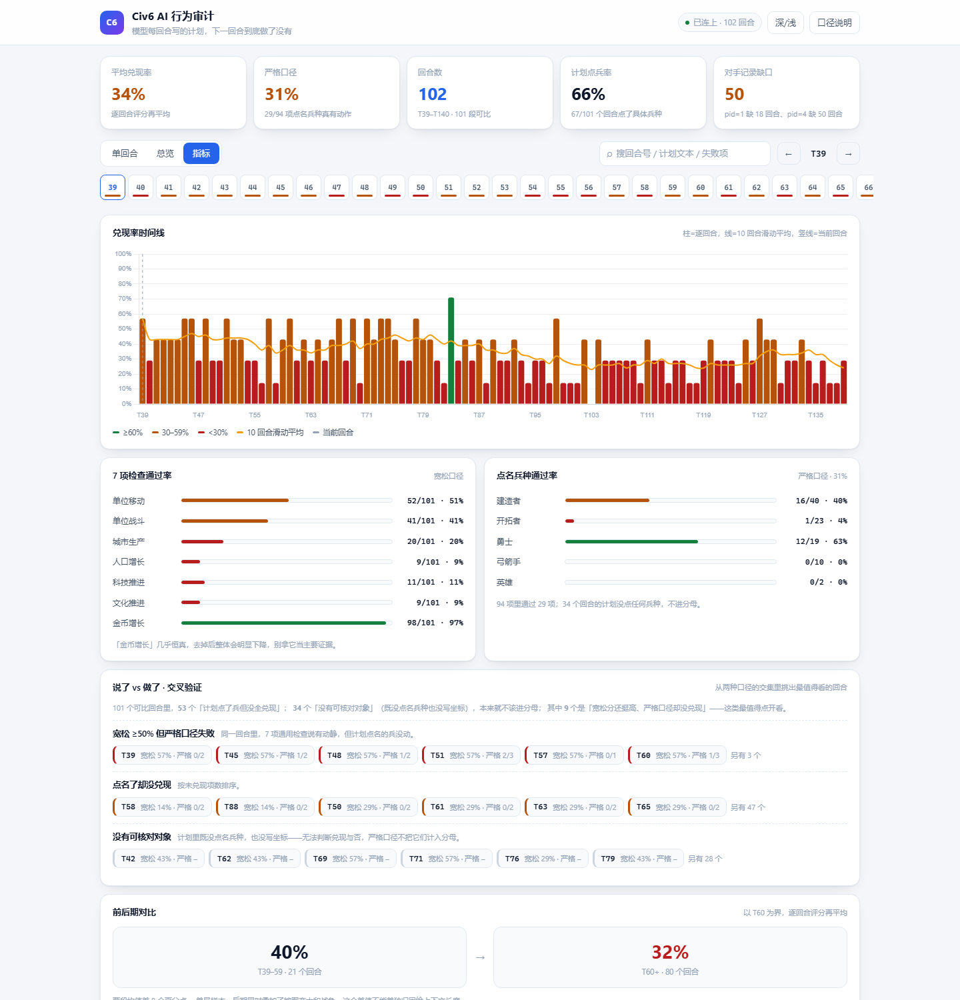

# Civ6 AI Agent 行为审计

让 DeepSeek 通过 MCP 协议玩《文明6》，看它每回合写下的"计划"，下一回合到底有没有执行。

> **关于这个仓库**
>
> **代码主要由 AI 辅助实现；我负责的是设计与审计**——定义"怎么算兑现"这个指标（宽松 33.9% / 严格 30.9% 双口径）、设计每回合的采集方案与数据契约（计划 / 预测 / 真实状态的三层对账）、审计产出并修复缺陷。
>
> `civ6-mcp/` 是上游开源项目，未纳入本仓库版本管理。本仓库记录的是我加在它外面的**审计与评估**部分。
>
> 所以请把它当成"一个人的审计实验"，而不是"一个工程团队的产品"。

## 为什么做这个

起因是一个挺实际的问题：Agent 汇报"任务已完成"的时候，我们凭什么信它？

我想找一个规则明确、状态可精确读取、而且跑得够久的场景来量化这件事。策略游戏刚好合适——一局几百回合，棋盘状态全部从引擎里读，不靠截图或视觉识别，也就没有"看错"这一层。

所以做法是：让模型每回合结束时写下计划（`planning`）和对下一回合的预测（`hypothesis`），把这句话和下一回合的真实游戏状态做对比，看它说的和做的是否一致。

## 数据

采集 T039–T140 共 102 个回合（其中 101 个可比对）。每个回合一个 JSON 快照，总量 1.32 MB，单文件平均 13.2 KB。

| 口径 | 兑现率 | 复算方式 |
|---|---|---|
| 宽松：7 项通用游戏进展检查 | 33.9% | `python analysis/compare_loose.py` |
| 严格：从计划里抽出具名兵种，核对是否真有行动 | 30.9% | `python analysis/strict_plan_check.py` |

两种聚合口径别混：脚本报的 33.9% 是"通过项 ÷ 总项数"（240/707）；界面上的 34% 是"先算每回合百分比、再对 101 个回合求平均"。值几乎一样，但换成小样本时这两个口径会分开走，引用时请说清是哪个。

宽松口径这 7 项是单位移动、单位战斗、城市生产、人口、科技、文化、金币。它跟模型写的计划文本其实没有直接关系——更像在测"行动密度"。严格口径才是真的在对账：计划里点了名的兵种，下一回合是不是真的动了（移动、造成伤害或从快照消失；只是被打掉血不算，那是别人执行的动作）。

按严格口径，101 个回合里有 34 个的计划根本没点任何兵种，不进分母。剩下的 94 项里最刺眼的是「开拓者」——23 次被点名，只有 1 次真有行动。建城本来就跨回合，但这也说明"计划提到某单位"和"这个单位真动了"是两件事。

计划文本本身也很短：平均 32.6 个字符，只有 4 条（4/102）提到具体坐标。"加速发展""持续改良"这种话，你没法判断它做没做。

## 已知问题

复算指标的时候发现了几处问题，按严重程度记在这里。

**Java 的 `TurnData` 漏了 `players` 字段，前端有 3 项检查一次都没跑过。** 这个最隐蔽：前端 `calculateScore` 把"科技推进/文化推进/金币增长"三项挂在 `current.players` 上，而 Java 反序列化时 `TurnData` 里没有这个字段，接口返回的对象里压根没这个键，`playerNow`/`playerNext` 都是 `undefined`，`if (playerNow && playerNext)` 直接跳过。于是**界面一直只算 4 项、显示平均 30%，而 README 写的是 7 项的 34%**——两边都能自圆其说，谁也没报错。金币那项 97% 恒真、去掉后掉到 23.4% 的现象，在界面上根本看不到。已补 `PlayerInfo` 模型，现在界面 7 项齐全，平均 34%，前后期 40%/32%，和脚本对上了。

**前端总览表的「单位」列曾经永远显示失败。** `renderOverviewTable` 查的标签是"单位行动"，而 `calculateScore` 推入的标签是"单位移动"和"单位战斗"，`find` 永远返回 `undefined`，那一列全是 ❌。已改成查两个真实标签。

**金币那一项几乎恒真。** 通过率 97%（98/101），因为每回合金币收入本来就是正的，我方金币从 156 一路涨到 556，从没跌破过 0。零方差的检查项放在分母里只会抬高平均分：去掉它，平均从 33.9% 掉到 23.4%（142/606）。

**城市和人口检查只看了第一座城。** 代码里是 `find(c => c.pid === 0)`，但实测 78/102 个回合玩家有多座城市（第 39 回合我方就有西安、太原、咸阳三座），这两项一直在漏算。

**同一套评分逻辑写了两遍。** Java 那边覆盖 2 项（单位变化、城市生产），前端覆盖 7 项。上面两个 bug 都是这两份实现分叉的产物——"文案改一半"没人发现，因为两边都不报错。应该下沉到一处，现在连 Python 脚本一共三份。

**文档和代码的数字对不上，而且不止一次。** 早期 README 写的是"130 回合 / 30%"，那是手抄的，实际是 102 回合。我给自己定的规矩是"指标必须由脚本产出，不能手写在文档里"，但这轮又抓到三个反例：严格的 26%（那版实现没留下来，谁也复算不了，已换成能跑出 30.9% 的脚本）、"每回合 2MB"（实测 1.32MB 总量，差两个数量级）、"计划平均 37 字符"（实测 32.6）。

**快照缺了部分 AI 玩家。** pid=4 在 91–140 回合整体缺席，pid=1 在 123–140 缺席。单局审计用不到这两家，但任何"跨文明对比"或"分数排名"都不能直接用这份快照，否则分母会随回合变形。

每个请求都会把 102 个文件全读一遍并解析，实测 116–383ms（含序列化 219KB 响应）。1.32MB 的数据量不是瓶颈，回合数上到 10⁵ 才会。前端 `calculateAllScores()` 原来每次渲染算 3 遍，现在加了缓存只算一次；这处开销没有单独实测过。

### 关于"兑现率随回合下降"

T39-59 平均 40.2%，T60 之后 32.5%（都是按宽松口径、逐回合评分后再平均）。我倾向解释为长上下文下注意力被稀释，**但这是猜测**——单局游戏、两段样本分别只有 21 和 80 个，后期同时还伴随地图变复杂、进入战争状态，混杂变量没排除。要验证得固定存档、只改上下文长度做消融实验。

这两个数字按 `analysis/compare_loose.py` 复算过，和正文一致。趋势图上是波动下降，不是单调下降，所以这里不说"持续下降"。

---

## 界面预览



*指标页。柱子是逐回合兑现率（绿 ≥60%、黄 30–59%、红 <30%），橙线是 10 回合滑动平均。下面是 7 项检查、点名兵种的通过率，以及「说了 vs 做了」交叉验证——它把「宽松分高但严格口径没兑现」的回合直接挑出来，点一下跳到详情。平均 34%，T39-59 是 40%，T60 之后 32%。*

前端三个视图：

- **单回合**：左边是 AI 写的计划和预测，右边是下一回合实际发生的事和得分；下面是 7 项检查、严格口径的逐兵种对账，以及当前资产/城市/单位快照。右上角「复制摘要」可把这一回合导成 Markdown（剪贴板被浏览器拦住时会弹出已选中的文本框让你手动复制）。
- **总览**：102 个回合的表格，带未通过项和计划摘要。表头可排序（回合/兑现率/严格口径），筛选胶囊可以只看「严格口径失败」「无可核对对象」「兑现率 < 30%」；搜索框按回合号、计划文本或失败项名过滤。
- **指标**：时间线（悬停直接显示该回合的未通过项和严格口径）、逐项通过率、点名兵种通过率、**说了 vs 做了交叉验证**（从两种口径的交集里挑出「宽松分高但严格没兑现」的回合，点一下就跳过去）、前后期对比、数据质量说明。

交互：`←`/`→` 切回合，`Home`/`End` 跳首尾，`1`/`2`/`3` 切视图，地址栏带 `#view=overview&f=strictFail&sort=score&dir=desc` 这样的状态可以直接分享。深色主题是本地开关，存在 localStorage。

评分逻辑单独放在 `frontend/metrics.js`，渲染在 `app.js`——这是重构的主要目的：之前评分和渲染混在一个文件里，改一处会牵连另一处。逐回合对比结果现在只算一次并缓存，搜索和排序不再重复计算。

---

## 技术架构

```
┌─────────────┐
│  浏览器      │
│  (前端可视化) │
└──────┬──────┘
       │ HTTP (fetch)
       ↓
┌─────────────┐
│  Java 后端   │  ← REST API（JDK 自带 HttpServer；JSON 用 Jackson）
│  :8080      │
└──────┬──────┘
       │ 读文件
       ↓
┌─────────────┐
│  JSON 数据   │  ← 102 回合的游戏状态快照
│  (collected) │
└──────┬──────┘
       │ 采集
       ↓
┌─────────────┐
│  civ6-mcp    │  ← MCP 协议驱动 LLM 玩《文明6》
│  + DeepSeek  │
└─────────────┘
```

---

## 技术栈

| 层 | 技术 | 说明 |
|---|---|---|
| 数据采集 | Python + MCP | 基于 civ6-mcp，通过 FireTuner 连游戏 |
| 数据存储 | JSON | 每回合一个文件 |
| 后端 | Java 17 | JDK 自带 HttpServer（实际依赖 Jackson 做反序列化） |
| 前端 | HTML + CSS + JS | 原生实现，Chart.js 本地化 |

## 怎么跑起来

先说清楚依赖边界，这决定了你要不要开游戏：

| 组件 | 需要《文明6》在跑吗 | 说明 |
|---|---|---|
| 评估器（Java 后端） | **不需要** | 只读 `data/collected/*.json` |
| 前端可视化 | **不需要** | 只是取后端的 HTTP 接口 |
| 指标复算 / 分析脚本 | **不需要** | 同样只吃 JSON 快照 |
| `civ6-mcp`（让 Agent 真的下棋） | **必须** | 通过 FireTuner 连游戏 TCP 4318，游戏不开就连不上 |

**改评分逻辑、看可视化、复算指标，全程不用启动游戏。** 只有采集新数据、或让模型继续下那一局时才需要开游戏。

### 最快路径（离线，不需要游戏）

```bat
run-evaluator.bat
```

它会依次做：编译评估器 → 起 API `:8080` → 起前端 `:8000` → 提示访问地址。
有 Maven 就用 `mvn compile`，没有就用 `javac` 加本机 `.m2` 里的 Jackson 兜底。

浏览器访问：`http://localhost:8000/frontend/`

前端会按**页面的主机名**去调 `:8080`（用 `127.0.0.1` 打开就调 `127.0.0.1`，用局域网 IP 打开也能用），所以不需要改代码。如果页面显示「API 连不上」，先确认 `http://127.0.0.1:8080/api/turns` 在浏览器里能直接打开——有些环境把 `localhost` 解析到 IPv6，而后端只监听 IPv4。

### 手动跑

需要 Java 17+（后端）和 Python 3.11+（只为起静态前端）。

```bash
# 在项目根目录执行 —— 数据目录默认取 ./data/collected，所以别在子目录里启动
cd evaluator && mvn compile
java -cp "target/classes;%USERPROFILE%\.m2\repository\com\fasterxml\jackson\core\jackson-databind\2.16.1\jackson-databind-2.16.1.jar;..." com.civ.eval.ApiServer

# 另开一个终端，仍在项目根目录
python -m http.server 8000 --bind 127.0.0.1
```

数据目录的解析顺序（已不再写死个人绝对路径）：

1. `-Dciv6.eval.dataDir=D:/some/where/collected`
2. 环境变量 `CIV6_DATA_DIR`
3. 默认：当前工作目录下的 `data/collected`

> 注意 `python -m http.server` 不带 `--bind 127.0.0.1` 时会监听所有网卡，而它把整个项目目录都暴露出去（含 `.git`、快照数据）。局域网不可信时务必加上这个参数。

### 要开游戏的那条路

```bat
civ6claude.bat
```

前置条件（缺一个就连不上）：Steam 里装了 **Civ 6 SDK**（FireTuner 在 SDK 里，不在游戏本体）、游戏内开启 Tuner、关掉 `FireTuner.exe`、关掉 Auto End Turn、已读档、**不要从 WSL 跑**。它还会写 Cline 的 MCP 配置并打开 VS Code。

`civ6-mcp` 本身没有离线模式：`connection.py` 直接连 `127.0.0.1:4318`，连不上就报 `Is the game running with EnableTuner=1?`。所以「不想开游戏」和「让 Agent 下棋」这两件事无法同时成立——但评测/可视化那半边完全不需要游戏。

### API 接口

| 接口 | 说明 |
|---|---|
| `GET /api/turns` | 获取所有回合列表 |
| `GET /api/analysis?turn=N` | 获取指定回合的分析结果 |
| `GET /api/all` | 获取所有回合的完整数据 |

---

## 项目结构

```
CivilizationVI/
├── civ6-mcp/                     # MCP 服务器（上游原项目，未纳入本仓库版本管理）
├── evaluator/                    # Java 后端：加载快照 + 对比 + REST API
│   ├── pom.xml
│   └── src/main/java/com/civ/eval/
│       ├── ApiServer.java        # REST API 服务
│       ├── Main.java             # 命令行分析入口
│       ├── analyzer/             # 对比分析逻辑
│       ├── loader/               # JSON 加载器
│       └── model/                # 数据模型
├── frontend/                     # 前端可视化
│   ├── index.html
│   ├── metrics.js                # 唯一一份评分口径（宽松 7 项 + 严格逐兵种）
│   ├── app.js                    # 只负责取数、状态、渲染、图表
│   ├── style.css                 # 主题变量 + 深浅色
│   └── chart.js                  # Chart.js 4.5.1，本地化
├── analysis/
│   ├── compare_loose.py          # 宽松 7 项口径（权威实现）
│   ├── strict_plan_check.py      # 严格口径：计划点名兵种 vs 实际动作
│   └── compare_temp.py           # 更早的打印式对比脚本，不算指标
├── legacy/
│   ├── collection.bat            # 早期采集方案（已废弃，见 legacy/README.md）
│   └── README.md
├── docs/
│   └── screenshot.png
├── data/
│   └── collected/                # 102 回合的 JSON 数据（T039–T140）
│       ├── turn_039.json
│       ├── ...
│       └── turn_140.json
├── run-evaluator.bat             # 离线跑评估器 + 前端（不需要游戏）
└── civ6claude.bat                # 需要游戏的那条路：装环境 + 打开 VS Code
```

（`collector/` 目录不在这份仓库里，早期对比脚本是 `analysis/compare_temp.py`。）

---

## 分析方法

### 数据采集

每回合结束时，`civ6-mcp` 自动导出：

- **AI 承诺**（planning）：AI 计划做什么
- **AI 预测**（hypothesis）：AI 预测会发生什么
- **游戏状态**：单位位置/血量/移动力、城市生产与人口、六家的科技与文化进度、外交与交易状态

快照的字段口径不统一，用之前必须知道：

- `units` 只有我方的兵（`players` 里那个 `is_agent` 字段 102 个回合全是 `false`，认我方只能认 pid=0）；
- `cities` 和 `players` 是全部六家的，所以城市相关的检查必须先按 `pid === 0` 过滤；
- 缺了部分 AI：pid=4 在 91–140 回合整体缺席，pid=1 在 123–140 缺席。

### 数据样例

每个回合的数据结构（截自我方视角，省略了无关字段）：

```json
{
  "turn": 39,
  "game": "china_1689496",
  "reflections": {
    "planning": "下回合合击击杀弓箭手；城市达4人口后考虑粮仓；建造者完工后改良棉花。",
    "hypothesis": "第40回合：弓箭手(66HP)可能远程射击我方单位；下回合两勇士可完成击杀。"
  },
  "units": [
    { "id": 327681, "type": "UNIT_WARRIOR", "x": 52, "y": 35, "damage": 20, "moves": 0 }
  ],
  "cities": [
    { "pid": 0, "city_id": 1, "city": "西安", "producing": "UNIT_BUILDER", "pop": 3 }
  ],
  "players": [
    { "pid": 0, "civ": "中国", "leader": "秦始皇（统一者）", "gold": 156.0,
      "techs_completed": 4, "civics_completed": 2, "cities": 1, "pop": 3 }
  ]
}
```

### 对比算法

拿相邻两回合的快照做差分：单位看位置变化、损伤变化、是否消失；城市看生产项、人口；玩家看科技、文化、金币有没有推进。

```
兑现率 = 通过项 / 总项数
```

严格口径多一步对账：先把 planning 里点名的兵种抽出来（固定词表：勇士/战士/弓箭手/建造者/开拓者/商人/英雄），再看这些兵种下一回合是不是真的动了。

### 评分粒度

七个检查项等权：单位移动、单位战斗、城市生产、人口增长、科技推进、文化推进、金币增长。

（这七项等权是早期拍的，现在看有问题——金币那一项几乎恒真，等于给分母灌水。另外城市和人口两项都只看 pid=0 的第一座城，玩家多城时漏算。）

口径的权威实现在 `analysis/compare_loose.py`（宽松 7 项）和 `analysis/strict_plan_check.py`（严格按兵种对账）。前端的 7 项是同一套口径的 JS 版本，两边已按 34% 对齐过；改口径请两边一起改，并重跑脚本核对。

---

## 可视化

前端三个视图：回合总览表、单回合详情（模型写的计划 + 游戏真实发生的）、趋势图与阶段对比。

## 后面想做的

- 把评分收敛到一处：现在 Java 2 项、前端 7 项、Python 两套脚本，四处口径各有偏差，这次已经踩了三回（`players` 漏字段、标签对不上、只看第一座城）
- 严格口径接进前端：现在 30.9% 只能跑脚本看，界面上没有
- 真正实现按排名融合的评分口径（现在 7 项等权，不适合）
- 固定存档跑多模型对照（DeepSeek vs GPT vs Claude）

## License

MIT